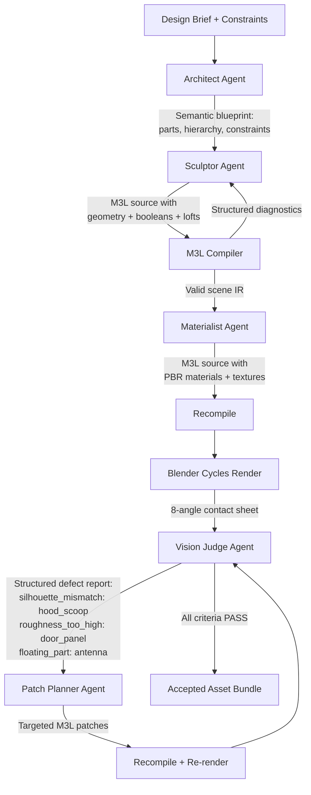
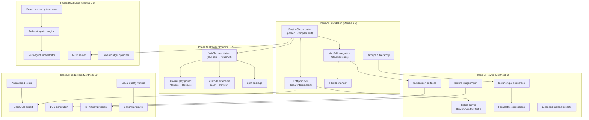

# M3L SUPREMACY PLAN — Making M3L the Undisputed Gold Standard for AI 3D Asset Generation

> **Document version:** 1.0 — 3 November 2026
> **Scope:** Every dimension of M3L — language, compiler, geometry kernel, materials, rendering, AI integration, runtime, tooling, ecosystem, and implementation language — evaluated from first principles with concrete actions.

---

## Table of Contents

1. [Diagnosis: Where M3L Stands Today](#1-diagnosis-where-m3l-stands-today)
2. [The Language Question: Should We Leave Python?](#2-the-language-question-should-we-leave-python)
3. [Tier 1 — Geometry Kernel Revolution](#3-tier-1--geometry-kernel-revolution)
4. [Tier 2 — Language & Grammar Evolution](#4-tier-2--language--grammar-evolution)
5. [Tier 3 — Material & Shading System Overhaul](#5-tier-3--material--shading-system-overhaul)
6. [Tier 4 — Real-Time In-Browser Compiler (WASM)](#6-tier-4--real-time-in-browser-compiler-wasm)
7. [Tier 5 — AI Orchestration & Self-Healing Loop](#7-tier-5--ai-orchestration--self-healing-loop)
8. [Tier 6 — Production Pipeline & Multi-Format Export](#8-tier-6--production-pipeline--multi-format-export)
9. [Tier 7 — Animation, Rigging & Physics](#9-tier-7--animation-rigging--physics)
10. [Tier 8 — Visual Quality Engine](#10-tier-8--visual-quality-engine)
11. [Tier 9 — Developer Experience & Ecosystem](#11-tier-9--developer-experience--ecosystem)
12. [Tier 10 — Benchmarking & Competitive Moat](#12-tier-10--benchmarking--competitive-moat)
13. [Implementation Sequence & Dependencies](#13-implementation-sequence--dependencies)
14. [Architecture Target State](#14-architecture-target-state)

---

## 1. Diagnosis: Where M3L Stands Today

### What M3L does well (genuine strengths to protect)

| Strength | Evidence |
|:---|:---|
| **AI-safe declarative language** | Zero `eval()`, zero imports, zero side-effects. No other 3D tool can make this claim. |
| **Structured diagnostic feedback** | 40+ error codes (E001–E196) with line numbers, field names, and repair suggestions. LLMs can self-heal. |
| **Deterministic compilation** | Same source + same compiler version = identical GLB output, byte-for-byte. |
| **Dual-target export** | GLB for runtime AND analytic B-rep STEP solids via OpenCascade — unique in AI 3D. |
| **Topology guarantees** | Every procedural mesh is audited: 2-manifold, watertight, consistent winding, zero degenerate triangles. |
| **Semantic versioning & diffing** | `asset_revision` hashes ignore formatting. `m3l diff` shows named semantic changes. Revision-guarded patches prevent stale overwrites. |
| **Asset bundle integrity** | `m3l build` + `m3l verify-bundle` produce SHA-256-verified, tamper-evident asset packages. |
| **Physical constraints** | `supported_by` validates contact and footprint containment, including concave extrusion profiles. |

### What M3L gets wrong or lacks entirely (the gap)

| Gap | Severity | Impact |
|:---|:---|:---|
| **No CSG booleans** (union, difference, intersect) | 🔴 Critical | Cannot cut holes, create slots, subtract shapes. Kills mechanical/industrial models. |
| **No loft primitive** (v0.6 not integrated) | 🔴 Critical | Cannot create cars, aerodynamic shapes, organic forms, bottle necks. |
| **No fillets, chamfers, or edge treatments** | 🔴 Critical | Every edge is razor-sharp. Real objects don't look like that. Kills visual realism. |
| **No subdivision surfaces** | 🟠 High | Cannot create smooth organic forms. Everything looks faceted at low poly. |
| **No spline curves or NURBS** | 🟠 High | Paths are piecewise-linear polylines. No smooth mathematical curves. |
| **No UV mapping control** | 🟠 High | Procedural UVs only. No seam placement, no atlas packing, no UV island control. |
| **No animation or rigging** | 🟠 High | Static scenes only. Unusable for games, film, or interactive applications. |
| **No real-time renderer** | 🟡 Medium | Must open GLB in external viewer. No live preview during authoring. |
| **Pure Python performance ceiling** | 🟡 Medium | Abyss 300 watch (281 objects): compile 100ms, GLB export 282ms. Fine now, blocks 10K+ object scenes. |
| **No instancing/referencing** | 🟡 Medium | Cannot reuse a defined sub-assembly. Every wheel must be fully re-declared. |
| **No groups or hierarchy** | 🟡 Medium | Flat object list. Cannot group "left_wheel" parts together. |
| **No conditional/parametric expressions** | 🟡 Medium | Cannot write `radius = base_radius * 0.5`. Every value is a literal. |
| **No texture image import** | 🟡 Medium | Cannot reference an external PNG/KTX2 texture file. Only procedural maps. |
| **No deformation/morph targets** | 🟡 Medium | Cannot do blend shapes, facial expressions, or soft-body deformation. |
| **No physics simulation** | 🟡 Medium | Cannot verify interference, gravity settling, or collision. |

### Performance baseline (measured)

| Scene | Objects | Compile (ms) | GLB Export (ms) | GLB Size |
|:---|:---|:---|:---|:---|
| bracket.m3l | 5 | 0.92 | 0.30 | 6.3 KB |
| vase.m3l | 2 | 16.5 | 6.3 | 43.9 KB |
| robot.m3l | 14 | 0.99 | 1.69 | 49 KB |
| abyss_300_chronograph.m3l | 281 | 99.5 | 282 | 2.1 MB |
| apex_orbital_probe.m3l | 24 | ~15 | ~40 | 4.9 MB (w/ textures) |

---

## 2. The Language Question: Should We Leave Python?

> [!IMPORTANT]
> **Verdict: Keep Python as the primary language. Add Rust/C++ as a compiled acceleration layer for the geometry kernel and WASM target only.**

### Full analysis

| Factor | Stay Python | Rewrite in Rust/C++ | Hybrid (Python + Rust core) |
|:---|:---|:---|:---|
| **Development velocity** | ✅ Fastest iteration | ❌ 3–5× slower development | ✅ Fast where it matters |
| **AI ecosystem** | ✅ Native (LangChain, OpenAI, Anthropic SDKs) | ❌ FFI bridges needed | ✅ Python orchestration |
| **Geometry performance** | ❌ 100× slower than C++ for heavy meshes | ✅ Native speed | ✅ Hot path in Rust |
| **WASM compilation** | ❌ No clean path to browser | ✅ Native `wasm32` target | ✅ Rust core → WASM |
| **NumPy/SciPy** | ✅ Already used for textures | N/A | ✅ Keep for texture gen |
| **Community accessibility** | ✅ Most AI devs know Python | ❌ Smaller pool | ✅ Python API surface |
| **Migration risk** | ✅ Zero | ❌ 6–12 month full rewrite | 🟡 Incremental, low risk |
| **Existing codebase** | ✅ 200KB, 63 tests, working | ❌ All thrown away | ✅ Preserved |

### Recommended architecture

```
┌──────────────────────────────────────────────────────┐
│  Python Layer (keep & extend)                        │
│  ┌────────┐ ┌──────────┐ ┌───────┐ ┌──────────────┐ │
│  │ Parser │ │ Compiler │ │ Judge │ │ AI Orchestr. │ │
│  │  (py)  │ │   (py)   │ │ (py)  │ │    (py)      │ │
│  └────┬───┘ └────┬─────┘ └───┬───┘ └──────────────┘ │
│       │          │           │                       │
│  ┌────▼──────────▼───────────▼────────────────────┐  │
│  │  Rust/C++ Acceleration Core (via PyO3 / FFI)   │  │
│  │  ┌─────────────┐ ┌──────────────┐ ┌─────────┐ │  │
│  │  │ CSG Booleans │ │ Subdivision  │ │ Remesh  │ │  │
│  │  │ (Manifold)   │ │ Surfaces     │ │ Engine  │ │  │
│  │  └─────────────┘ └──────────────┘ └─────────┘ │  │
│  │  ┌─────────────┐ ┌──────────────┐ ┌─────────┐ │  │
│  │  │ Spline/NURBS │ │ Fillet/Bevel │ │ Loft    │ │  │
│  │  │ Evaluator    │ │ Generator    │ │ Builder │ │  │
│  │  └─────────────┘ └──────────────┘ └─────────┘ │  │
│  └────────────────────────────────────────────────┘  │
│       │                                              │
│  ┌────▼──────────────────────────────────────────┐   │
│  │  Same Rust Core → WebAssembly (wasm32)        │   │
│  │  Runs in browser for live M3L→Three.js bridge │   │
│  └───────────────────────────────────────────────┘   │
└──────────────────────────────────────────────────────┘
```

### Why not a full Rust rewrite?

1. **The parser, compiler, and AI loop are NOT bottlenecks.** Parsing 1,534-line M3L in pure Python takes <1ms. The semantic compiler for 281 objects takes 100ms. These are fine.
2. **The bottleneck is the geometry kernel** — ear-clipping triangulation, revolve mesh generation, and sweep frame transport. These inner loops benefit from compiled code.
3. **Full rewrite destroys 6 months of tested, working code** for zero user-visible benefit in parser/compiler/judge.
4. **Python IS the AI orchestration language.** Every LLM SDK, every agent framework, every ML pipeline is Python-first. Rewriting M3L in Rust would require maintaining Python bindings for every AI integration anyway.

### Action items

| Action | Priority | Tool |
|:---|:---|:---|
| Create `m3l-core` Rust crate for geometry hot paths | P0 | Rust + PyO3 |
| Bind Manifold (C++) for CSG booleans via Rust wrapper | P0 | manifold3d, cxx |
| Compile `m3l-core` to WASM for browser target | P1 | wasm-pack |
| Keep parser.py, compiler.py, judge.py, api.py in Python | — | — |
| Use `numpy` vectorized ops where Rust FFI is overkill | P2 | numpy |

---

## 3. Tier 1 — Geometry Kernel Revolution

> [!CAUTION]
> This is the single most important tier. Without these primitives, M3L cannot compete with Three.js, Blender, or any serious 3D tool. Everything else is secondary.

### 3.1 CSG Boolean Operations (CRITICAL — Blocks Everything)

**Current state:** Zero boolean support. Cannot cut holes, subtract shapes, or create mechanical assemblies.

**Target:**
```m3l
boolean engine_block {
  op = difference
  base = block_casting
  tools = [cylinder_bore_1, cylinder_bore_2, oil_channel, coolant_passage]
}

boolean decorative_frame {
  op = union
  parts = [outer_ring, inner_cross, corner_fillets]
}
```

**Implementation plan:**
1. Integrate [Manifold](https://github.com/elalish/manifold) (Emmett Lalish, Google) — the fastest guaranteed-watertight boolean engine in existence.
2. Manifold is C++ with a clean API. Wrap it via Rust (cxx) or directly via ctypes/cffi.
3. Manifold guarantees output is always a valid 2-manifold solid — perfect for M3L's topology audit philosophy.
4. Supported operations: `union`, `difference`, `intersect`, `xor`.
5. Tool operands can be named objects or inline anonymous primitives.
6. Recursive booleans: the result of one boolean can be a tool for another.
7. Maximum nesting depth: 16 levels (prevent LLM runaway).
8. Maximum tool count per operation: 64 (bounded).

**Diagnostics to add:**
- `E200`: Boolean operand references unknown object.
- `E201`: Boolean creates degenerate result (zero volume).
- `E202`: Boolean nesting depth exceeds limit.
- `E203`: Boolean tool and base share no overlapping volume (warning).

### 3.2 Loft Primitive (CRITICAL — Unblocks Automotive/Organic)

**Current state:** `loft` syntax exists in v0.6 experimental source but is NOT implemented in the v0.5 compiler/geometry engine.

**Target:**
```m3l
loft fuselage {
  sections = [
    { profile = [[0,0], [0.5,0], [0.5,0.3], [0,0.3]], at_y = 0.0 },
    { profile = [[0,0], [0.8,0], [0.8,0.5], [0,0.5]], at_y = 1.0 },
    { profile = [[0,0], [0.4,0], [0.4,0.2], [0,0.2]], at_y = 2.5 }
  ]
  interpolation = cubic  # linear | cubic | catmull_rom
  segments = 32
  material = hull_composite
}
```

**Implementation plan:**
1. Accept 2–32 cross-section profiles positioned along Y.
2. Cross-sections can have different vertex counts — use arc-length correspondence.
3. Linear interpolation (immediate): simply connect corresponding vertices between adjacent sections.
4. Cubic interpolation (next): Catmull-Rom or Hermite splines through corresponding vertex sequences.
5. Each inter-section band is triangulated as a quad strip (2 triangles per quad).
6. End caps: automatic ear-clip triangulation of first and last profiles.
7. Topology audit: verify watertight closure, consistent winding, 2-manifold.

### 3.3 Fillets and Chamfers (CRITICAL — Visual Realism)

**Current state:** Every edge is infinitely sharp. No edge treatment of any kind.

**Target:**
```m3l
box motor_housing {
  size = [0.5, 0.3, 0.4]
  fillet = 0.015          # uniform radius on all edges
  fillet_segments = 6     # tessellation quality
  material = cast_aluminum
}

extrude bracket_arm {
  profile = [...]
  depth = 0.08
  chamfer_top = 0.003     # flat bevel on top edges only
  material = steel
}
```

**Implementation plan:**
1. **Approach A (Manifold offset):** Use Manifold's offset/minkowski operations to create rounded edges analytically.
2. **Approach B (Mesh-level):** Implement edge-beveling directly on the indexed mesh:
   - Identify sharp edges (dihedral angle > threshold).
   - Insert intermediate vertices along a circular arc (fillet) or flat cut (chamfer).
   - Re-triangulate affected faces.
3. **Approach C (Subdivision proxy):** Tag edges as crease/smooth, apply one level of Catmull-Clark subdivision, then re-triangulate.
4. Bounded: `fillet_segments` capped at 1–16. `fillet` radius must be less than half the smallest adjacent face dimension.

### 3.4 Subdivision Surfaces

**Target:**
```m3l
subdivision smooth_body {
  base = rough_hull         # reference to a box/extrude/loft/boolean
  levels = 2                # 1-4
  creases = [edge_a, edge_b]  # sharp feature lines
  material = painted_steel
}
```

**Implementation plan:**
1. Implement Catmull-Clark subdivision on indexed quad/tri meshes.
2. Support crease edges (maintain sharpness at tagged edges).
3. Level cap: 1–4 (prevent exponential mesh explosion).
4. Input mesh: any M3L-generated solid (box, extrude, loft, boolean result).

### 3.5 Spline Curves and NURBS Paths

**Current state:** `sweep` uses piecewise-linear polylines only.

**Target:**
```m3l
sweep cable_harness {
  path_type = cubic_bezier
  control_points = [[0,0,0], [0.5,0.3,0], [1.0,0.6,0.2], [1.5,0.4,0.1]]
  radius = 0.008
  segments = 32
  path_segments = 64    # tessellation along the curve
  material = rubber_insulation
}
```

**Implementation plan:**
1. Add `path_type` field: `linear` (current default), `cubic_bezier`, `catmull_rom`, `b_spline`.
2. Evaluate the parametric curve into a dense polyline (`path_segments` points), then feed into existing sweep builder.
3. Also usable for loft guide rails and extrusion paths in future.

### 3.6 Torus Primitive

```m3l
torus seal_ring {
  major_radius = 0.25
  minor_radius = 0.015
  segments = 48
  rings = 24
  material = rubber_gasket
}
```

Simple to implement: parametric (θ, φ) surface → standard indexed mesh.

### 3.7 Cone and Frustum Primitives

```m3l
cone exhaust_tip {
  radius_bottom = 0.12
  radius_top = 0.06     # 0 = perfect cone, >0 = frustum
  height = 0.35
  segments = 32
  material = brushed_stainless
}
```

### 3.8 Mesh Import (OBJ/STL/PLY)

```m3l
import_mesh detailed_sculpture {
  file = "assets/bust_scan.obj"
  scale = [0.001, 0.001, 0.001]   # mm to meters
  material = marble
}
```

**Rules:**
- File path is relative to the `.m3l` source file.
- Maximum vertex count: 500,000 (bounded).
- Mesh is validated through the standard topology audit.
- Imported meshes can be used as CSG boolean operands.
- Files are referenced, not embedded in M3L source — keeps source AI-friendly.

---

## 4. Tier 2 — Language & Grammar Evolution

### 4.1 Groups and Hierarchy

**Current state:** Flat list of objects. No nesting, no sub-assemblies.

**Target:**
```m3l
group left_wheel_assembly {
  at = [-0.6, 0.15, 0.8]
  rotate = [0, 15, 0]

  revolve tire { ... }
  revolve rim { ... }
  cylinder hub { ... }
  array lug_nuts { ... }
}
```

**Semantics:**
- Groups create a local coordinate system. Children transform relative to parent.
- Groups can contain objects, arrays, other groups (max depth: 8).
- Groups can be referenced by name in constraints and booleans.
- Groups are emitted as parent nodes in the glTF scene graph.

### 4.2 References and Instancing

**Current state:** Every identical part must be fully re-declared.

**Target:**
```m3l
prototype wheel_assembly {
  revolve tire { ... }
  revolve rim { ... }
}

instance front_left {
  prototype = wheel_assembly
  at = [-0.6, 0.15, 1.2]
  rotate = [0, 0, 0]
}

instance front_right {
  prototype = wheel_assembly
  at = [0.6, 0.15, 1.2]
  mirror = x
}
```

**Benefits:**
- Massive token savings for LLMs (4 wheels = 1 prototype + 4 one-line instances).
- GLB mesh instancing (GPU instancing in viewers).
- Edit one prototype → all instances update.

### 4.3 Parametric Expressions

**Current state:** All values are literal constants. No math, no references.

**Target:**
```m3l
scene "parametric_bolt" {
  param head_diameter = 0.012
  param shaft_diameter = head_diameter * 0.55
  param shaft_length = 0.025
  param head_height = head_diameter * 0.4

  cylinder head {
    radius = head_diameter / 2
    height = head_height
    at = [0, shaft_length + head_height / 2, 0]
    material = zinc_steel
  }

  cylinder shaft {
    radius = shaft_diameter / 2
    height = shaft_length
    at = [0, shaft_length / 2, 0]
    material = zinc_steel
  }
}
```

**Implementation plan:**
1. Add a `param` block at scene level. Params are named constants.
2. Expressions support: `+`, `-`, `*`, `/`, `min()`, `max()`, `sin()`, `cos()`, `sqrt()`, `pi`.
3. **NO user-defined functions, NO loops, NO conditionals** — keeps the language safe and deterministic.
4. Expressions are evaluated at compile time. The IR stores resolved numeric values only.
5. Implement with a simple recursive-descent expression evaluator (NOT `eval()`).

### 4.4 Enum Types for Common Patterns

```m3l
material polished_chrome {
  preset = chrome          # expands to base/roughness/metallic/clearcoat
  tint = "#e8e8f0"         # optional: modulate the preset base color
}
```

Add high-quality curated presets: `chrome`, `gold`, `copper`, `glass`, `water`, `skin`, `concrete`, `asphalt`, `fabric`, `wood_oak`, `wood_walnut`, `marble_white`, `marble_black`, `plastic_matte`, `plastic_glossy`.

### 4.5 Conditional Variants (Safe)

```m3l
variant high_detail {
  when = detail_level >= 2
  overrides = {
    segments = 128
    fillet_segments = 8
    texture_resolution = 1024
  }
}

variant low_detail {
  when = detail_level < 2
  overrides = {
    segments = 24
    fillet_segments = 2
    texture_resolution = 128
  }
}
```

Variants are compile-time switches, not runtime branches. The compiler evaluates the condition and applies overrides before geometry generation.

---

## 5. Tier 3 — Material & Shading System Overhaul

### 5.1 Texture Image Import

```m3l
material wood_table {
  base_texture = "textures/oak_diffuse.png"
  normal_texture = "textures/oak_normal.png"
  roughness_texture = "textures/oak_roughness.png"
  uv_scale = [2.0, 2.0]
  uv_offset = [0.0, 0.0]
}
```

### 5.2 Triplanar / World-Space Mapping

```m3l
material terrain_rock {
  base = "#7a6e5d"
  mapping = triplanar         # triplanar | box | cylindrical | spherical | planar
  mapping_scale = 0.5
  surface = "leather_grain"
  texture_resolution = 1024
}
```

### 5.3 Material Layers & Decals

```m3l
material weathered_metal {
  layer base {
    base = "#8998a8"
    roughness = 0.28
    metallic = 0.92
    surface = "brushed_metal"
  }
  layer rust_patches {
    base = "#6b3a1f"
    roughness = 0.85
    metallic = 0.20
    blend = noise
    blend_scale = 0.3
    blend_threshold = 0.6
    texture_resolution = 512
  }
}
```

### 5.4 UV Layout Control

```m3l
extrude panel {
  profile = [...]
  depth = 0.02
  uv_mode = planar_xz          # planar_xz | planar_xy | cylindrical | unwrap_auto
  uv_scale = [1.0, 1.0]
  uv_rotation = 45
  material = wood_panel
}
```

### 5.5 Expanded Procedural Surface Library

Add 20+ new surface presets:

| Category | Presets |
|:---|:---|
| **Metals** | `polished_steel`, `cast_iron`, `hammered_copper`, `gold_leaf`, `titanium_matte` |
| **Organics** | `tree_bark`, `moss`, `sand`, `soil`, `stone_rough`, `marble_veined` |
| **Manufactured** | `concrete_smooth`, `concrete_rough`, `brick`, `tile_ceramic`, `asphalt` |
| **Fabrics** | `denim`, `silk`, `canvas`, `knit_wool` |
| **Plastics** | `abs_matte`, `polycarbonate_clear`, `silicone`, `vinyl` |

### 5.6 KTX2 / Basis Universal Texture Compression

Currently all textures are uncompressed PNG. For production:
1. Generate textures at authoring resolution.
2. Compress to KTX2 / Basis Universal for GLB embedding.
3. Use `KHR_texture_basisu` extension.
4. Color textures: ETC1S (smaller). Normal/data textures: UASTC (higher fidelity).
5. This alone can reduce GLB size by 4–8×.

---

## 6. Tier 4 — Real-Time In-Browser Compiler (WASM)

### The goal

Type M3L source in a browser editor. See the 3D model update in real time. No server round-trip.

### Architecture

```
┌─────────────────────────────────┐
│  Browser Tab                    │
│  ┌───────────┐ ┌─────────────┐ │
│  │ Monaco    │ │ Three.js /  │ │
│  │ Code      │ │ WebGPU      │ │
│  │ Editor    │ │ Viewport    │ │
│  │ (M3L src) │ │ (live 3D)   │ │
│  └─────┬─────┘ └──────▲──────┘ │
│        │               │        │
│  ┌─────▼───────────────┘──────┐ │
│  │  m3l-core.wasm             │ │
│  │  parse → compile → mesh    │ │
│  │  → glTF JSON + bin buffers │ │
│  └────────────────────────────┘ │
└─────────────────────────────────┘
```

### Implementation plan

1. Write `m3l-core` Rust crate: parser + compiler + geometry + GLB serializer.
2. Mirror the existing Python logic faithfully (same diagnostics, same IR schema).
3. Compile to `wasm32-unknown-unknown` via `wasm-pack`.
4. JavaScript API: `m3l_compile(source: string) → { glb: Uint8Array, diagnostics: object[], scene: object }`.
5. Frontend: Monaco editor with M3L syntax highlighting + Three.js viewport.
6. On every keystroke (debounced 200ms): call WASM compile, if valid → update Three.js scene via GLTFLoader.
7. Diagnostics render as inline editor squiggles (like VSCode red underlines).

### Performance target

| Operation | Python (current) | WASM (target) |
|:---|:---|:---|
| Parse 1000-line source | ~0.5ms | ~0.05ms |
| Compile 100-object scene | ~50ms | ~2ms |
| Generate 10K triangle mesh | ~15ms | ~0.5ms |
| Full pipeline (parse → GLB) | ~100ms | ~5ms |

This makes M3L feel as instant as a text editor while maintaining every safety guarantee.

---

## 7. Tier 5 — AI Orchestration & Self-Healing Loop

### 5.1 Multi-Agent Architecture



### 5.2 Defect Taxonomy (Machine-Readable)

Define a formal defect schema that vision judges must output:

```json
{
  "defects": [
    {
      "type": "floating_part",
      "target": "antenna_mast",
      "confidence": 0.92,
      "view": "front_45",
      "action": "translate antenna_mast down by ~0.02 in Y or add supported_by constraint"
    },
    {
      "type": "silhouette_mismatch",
      "target": "rear_fender",
      "reference_view": "side_profile",
      "confidence": 0.78,
      "action": "widen the loft section at y=1.8 by 15%"
    }
  ]
}
```

Supported defect types: `floating_part`, `silhouette_mismatch`, `proportion_error`, `material_mismatch`, `missing_component`, `z_fighting`, `inverted_normals`, `black_faces`, `texture_stretch`, `symmetry_drift`, `edge_artifacts`, `gap_between_parts`, `interpenetration`, `over_tessellated`, `under_tessellated`.

### 5.3 Defect-to-Patch Mapping Engine

Build a rule engine that converts structured defects into M3L patch operations:

| Defect Type | Auto-Patch Strategy |
|:---|:---|
| `floating_part` | Adjust `at` Y coordinate to contact target surface; add `supported_by` constraint |
| `silhouette_mismatch` | Modify loft section profiles or primitive dimensions |
| `material_mismatch` | Swap material reference or adjust roughness/metallic |
| `gap_between_parts` | Adjust transforms to close gap |
| `symmetry_drift` | Mirror coordinates from the "good" side |
| `edge_artifacts` | Increase `fillet` radius or `segments` |
| `texture_stretch` | Change `uv_mode` or adjust `uv_scale` |

### 5.4 Token Budget Optimizer

Track cumulative LLM token usage per generation session:
- Set a hard budget (e.g., 100K tokens for a complete asset).
- After each repair round, estimate remaining budget.
- If budget is low, switch from "regenerate full source" to "surgical patch mode".
- Report tokens-per-accepted-asset as a first-class metric.

### 5.5 Model Context Protocol (MCP) Server

Expose M3L capabilities as an MCP server so any LLM client (Claude Desktop, Cursor, Windsurf, etc.) can:
- `m3l/validate` — validate source
- `m3l/compile` — compile to GLB
- `m3l/judge` — run preflight
- `m3l/diff` — semantic diff
- `m3l/patch` — apply patch
- `m3l/schema` — get language schema
- `m3l/capabilities` — discover available primitives and materials

---

## 8. Tier 6 — Production Pipeline & Multi-Format Export

### 6.1 OpenUSD Export

```bash
m3l export-usd scene.m3l --out scene.usdc
```

- Emit UsdGeomMesh with proper subdivision scheme tags.
- UsdShade material bindings with UsdPreviewSurface.
- UsdLux lights mapped from M3L light blocks.
- UsdSkel for rigged models (Tier 7).
- Native asset referencing and composition arcs.

### 6.2 FBX Export

Essential for Unity, Unreal Engine, Maya, and 3ds Max interop.

### 6.3 3MF Export

For 3D printing. Include:
- Mesh with manifold guarantee.
- Color/material per triangle.
- Build platform orientation.
- Unit conversion (M3L scene units → mm).

### 6.4 Automatic LOD Generation

```m3l
scene "game_asset" {
  lod_levels = 4

  # LOD0: full detail (as authored)
  # LOD1: 50% triangles (quadric decimation)
  # LOD2: 25% triangles
  # LOD3: 12% triangles (billboard proxy)
}
```

Output: multi-LOD GLB using `MSFT_lod` extension, or separate files.

### 6.5 Texture Atlas Packing

For game-ready assets, automatically:
1. UV-unwrap all parts into a shared atlas.
2. Bake per-material textures into shared atlas pages.
3. Reduce draw calls from N materials to 1.
4. Output size: 1K / 2K / 4K configurable.

### 6.6 Draco / Meshopt Compression

```bash
m3l compile scene.m3l --out scene.glb --compress meshopt
```

- `KHR_draco_mesh_compression`: aggressive geometry compression.
- `EXT_meshopt_compression`: GPU-decodable streaming compression.
- Reduces GLB size by 5–15× with minimal visual loss.

---

## 9. Tier 7 — Animation, Rigging & Physics

### 7.1 Declarative Joint System

```m3l
joint elbow {
  type = revolute          # revolute | prismatic | ball | fixed
  parent = upper_arm
  child = forearm
  anchor = [0, -0.15, 0]  # relative to parent
  axis = [1, 0, 0]
  limits = [-10, 145]     # degrees
}
```

### 7.2 Declarative Animations

```m3l
animation spin_radar {
  target = radar_dish
  channel = rotation_y
  keyframes = [
    { time = 0.0, value = 0 },
    { time = 2.0, value = 360 },
  ]
  interpolation = linear
  loop = true
}

animation breathe {
  target = chest_armor
  channel = scale
  keyframes = [
    { time = 0.0, value = [1.0, 1.0, 1.0] },
    { time = 1.5, value = [1.0, 1.05, 1.0] },
    { time = 3.0, value = [1.0, 1.0, 1.0] },
  ]
  interpolation = cubic
  loop = true
}
```

### 7.3 Morph Targets / Blend Shapes

```m3l
morph_target smile {
  base = face_mesh
  deltas = [
    { vertex = 42, offset = [0.002, 0.005, 0.001] },
    { vertex = 43, offset = [0.002, 0.004, 0.001] },
    ...
  ]
  weight = 0.0   # 0.0–1.0, animatable
}
```

### 7.4 Physics Constraints (Validation Only)

```m3l
constraint no_interpenetration {
  kind = clearance
  object_a = piston
  object_b = cylinder_wall
  min_distance = 0.001
}

constraint center_of_mass {
  kind = balance
  objects = [body, left_wing, right_wing, tail]
  target_com = [0.0, 0.3, 0.0]
  tolerance = 0.05
}
```

---

## 10. Tier 8 — Visual Quality Engine

### 8.1 Headless Render Farm Integration

Support multiple render backends:

| Backend | Use Case | Integration |
|:---|:---|:---|
| **Blender Cycles** (existing) | Hero renders, final review | Subprocess, fixed script |
| **Blender EEVEE** | Fast preview renders | Subprocess, fixed script |
| **Filament** (Google) | Fast PBR preview, headless | C++ lib, WASM possible |
| **Three.js headless** (Puppeteer) | Browser-consistent preview | Node.js subprocess |

### 8.2 Automated Multi-View Contact Sheet

For every compiled asset, automatically render:
1. Front, Back, Left, Right (orthographic silhouettes)
2. 3/4 Hero view (perspective, key+fill+rim lighting)
3. Top-down plan view
4. Material close-up (45° detail crop)
5. Wireframe overlay

### 8.3 Perceptual Quality Metrics

Implement computable (non-AI) quality signals:

| Metric | What It Measures | Implementation |
|:---|:---|:---|
| **Silhouette complexity** | Edge count / bounding circle ratio | Render silhouette → edge detection → ratio |
| **Normal smoothness** | Average dihedral angle variance | Computed from mesh normals |
| **UV stretch** | Max stretch ratio across all triangles | Compare 2D UV area to 3D surface area |
| **Triangle quality** | Min angle across all triangles | Direct mesh audit |
| **Symmetry score** | L/R deviation for symmetric assets | Mirror mesh, compute Hausdorff distance |
| **Material coverage** | % of surface area with non-default material | From compiled scene IR |
| **Detail distribution** | Triangle density variance across the model | Spatial binning of triangle areas |

### 8.4 Reference Image Comparison

```bash
m3l evaluate scene.m3l --reference refs/target_front.png --view front
```

1. Render M3L scene from the same camera angle.
2. Compute SSIM, LPIPS, and CLIP similarity scores.
3. Output structured comparison report.
4. Use for automated regression testing of visual quality.

---

## 11. Tier 9 — Developer Experience & Ecosystem

### 9.1 VSCode / Editor Extension

- **Syntax highlighting** for `.m3l` files (TextMate grammar).
- **Inline diagnostics** from the M3L compiler (Language Server Protocol).
- **Auto-complete** for material names, object types, property names.
- **Live 3D preview** panel (via WASM compiler + Three.js webview).
- **Hover documentation** for every property and primitive.
- **Go-to-definition** for material and object references.

### 9.2 Interactive Web Playground

A hosted web application:
1. Monaco editor (left) + Three.js viewport (right).
2. WASM M3L compiler runs client-side.
3. Pre-loaded examples with one-click load.
4. "Share" button generates a URL with the M3L source encoded.
5. "Export GLB" button downloads the compiled asset.
6. "Fork" button copies to user's workspace.

### 9.3 Python SDK

```python
import m3l

scene = m3l.Scene("robot_arm")
scene.param("arm_length", 0.5)
scene.material("steel", base="#8998a8", roughness=0.28, metallic=0.92)

with scene.group("segment_1", at=[0, 0, 0]):
    scene.cylinder("shaft", radius=0.03, height="arm_length", material="steel")
    scene.sphere("joint", radius=0.05, at=[0, "arm_length", 0], material="steel")

result = scene.compile()
result.export_glb("robot_arm.glb")
result.export_step("robot_arm.step")
print(result.diagnostics)
```

### 9.4 npm Package

```javascript
import { compile } from 'm3l-wasm';

const result = compile(m3lSource);
if (result.valid) {
  const blob = new Blob([result.glb], { type: 'model/gltf-binary' });
  // load into Three.js, Babylon.js, etc.
}
```

### 9.5 CLI Improvements

```bash
# Watch mode: recompile on file save
m3l watch scene.m3l --out scene.glb --serve 8080

# Batch compile a directory
m3l batch examples/ --out-dir dist/ --format glb,step,usd

# Interactive REPL
m3l repl

# Generate M3L from natural language (requires API key)
m3l generate "a medieval castle tower with battlements" --out castle.m3l
```

### 9.6 Documentation Site

- **Tutorial track:** "Your first M3L scene" → "Materials" → "Booleans" → "Lofts" → "AI integration".
- **API reference:** every primitive, property, constraint, and diagnostic code.
- **Gallery:** curated examples with live interactive viewers.
- **Cookbook:** "How to model a watch", "How to model a vehicle", "How to model furniture".
- **Architecture guide:** for contributors.

---

## 12. Tier 10 — Benchmarking & Competitive Moat

### 10.1 Standardized Benchmark Suite

Create a frozen benchmark of 20 tasks at 4 difficulty levels:

| Level | Example Tasks |
|:---|:---|
| **L1 — Simple** | Coffee mug, dice, pencil, simple chair |
| **L2 — Moderate** | Desk lamp with articulated arm, chess piece set, headphones |
| **L3 — Complex** | Wristwatch with subdials, motorcycle engine, architectural column |
| **L4 — Extreme** | Full vehicle exterior, mechanical keyboard, detailed robot character |

For each task, define:
- Natural language brief.
- Hard constraints (dimensions, part count, material requirements).
- Reference images (8 views).
- Acceptance criteria (topology, visual similarity threshold).

### 10.2 Competitive Comparison Framework

Compare M3L against:

| Competitor | Category | What To Measure |
|:---|:---|:---|
| **LLM → Three.js code** | AI imperative 3D | Success rate, safety, token cost, topology quality |
| **LLM → Blender Python** | AI scripted 3D | Success rate, crash rate, edit difficulty |
| **Meshy / Tripo3D** | AI generative mesh | Editability, topology quality, PBR accuracy, CAD export |
| **OpenSCAD** | Declarative CSG | Expressiveness, AI friendliness, visual quality |
| **CadQuery** | Python parametric CAD | Ease of AI generation, runtime preview, visual output |

### 10.3 Metrics Dashboard

Track and publish:
- First-compile success rate (% of LLM outputs that compile without repair).
- Accepted-output rate (% that pass all quality gates).
- Mean repair rounds to acceptance.
- Tokens per accepted asset.
- Compile latency (p50, p95, p99).
- GLB structural score distribution.
- Visual similarity score distribution (SSIM/LPIPS vs reference).

---

## 13. Implementation Sequence & Dependencies



### Priority matrix

| Priority | Items | Justification |
|:---|:---|:---|
| **P0 — Do First** | CSG booleans, Loft, Fillets, Groups, Rust core crate | Without these, M3L cannot model anything beyond toy scenes. |
| **P1 — Do Soon** | WASM compiler, Splines, Instancing, Parametric expressions, Extended materials | Makes M3L competitive with Three.js in browser and massively reduces LLM token costs. |
| **P2 — Do Next** | Multi-agent AI loop, VSCode extension, Playground, MCP server, Subdivision | Makes M3L a pleasure to use and unlocks autonomous asset generation. |
| **P3 — Do After** | OpenUSD, Animation, LODs, KTX2, FBX, 3MF, Physics constraints, Benchmark suite | Production readiness and ecosystem completeness. |

---

## 14. Architecture Target State

After all tiers are implemented, M3L becomes:

```
┌─────────────────────────────────────────────────────────────────┐
│                    M3L v2.0 Architecture                        │
│                                                                 │
│  ┌───────────────────────────────────────────────────────────┐  │
│  │ FRONTEND LAYER                                            │  │
│  │  ┌──────────┐ ┌──────────┐ ┌──────────┐ ┌─────────────┐ │  │
│  │  │ .m3l     │ │ Python   │ │ JS/TS    │ │ AI Agent    │ │  │
│  │  │ Source   │ │ SDK      │ │ SDK      │ │ (MCP/HTTP)  │ │  │
│  │  └────┬─────┘ └────┬─────┘ └────┬─────┘ └──────┬──────┘ │  │
│  └───────┼─────────────┼───────────┼───────────────┼────────┘  │
│          │             │           │               │            │
│  ┌───────▼─────────────▼───────────▼───────────────▼────────┐  │
│  │ CORE ENGINE (Rust + Python hybrid)                        │  │
│  │  ┌────────────┐ ┌──────────────┐ ┌────────────────────┐  │  │
│  │  │ Parser     │ │ Semantic     │ │ Diagnostics Engine │  │  │
│  │  │ (Rust/Py)  │ │ Compiler     │ │ (E001–E500+)       │  │  │
│  │  └────────────┘ └──────────────┘ └────────────────────┘  │  │
│  │  ┌────────────────────────────────────────────────────┐   │  │
│  │  │ GEOMETRY KERNEL (Rust, compiled to native + WASM)  │   │  │
│  │  │  Primitives | Extrude | Revolve | Sweep | Loft     │   │  │
│  │  │  CSG Booleans (Manifold) | Subdivision (Catmull-C) │   │  │
│  │  │  Fillets | Chamfers | Splines | Torus | Cone       │   │  │
│  │  │  Mesh Import | Remesh | Decimate | Topology Audit  │   │  │
│  │  └────────────────────────────────────────────────────┘   │  │
│  │  ┌────────────────────────────────────────────────────┐   │  │
│  │  │ MATERIAL ENGINE                                     │   │  │
│  │  │  Procedural PBR | Texture Import | Layers | Decals │   │  │
│  │  │  UV Mapping | Triplanar | Atlas Packing | KTX2     │   │  │
│  │  │  50+ Curated Presets | World-Space Consistency      │   │  │
│  │  └────────────────────────────────────────────────────┘   │  │
│  └───────────────────────────────────────────────────────────┘  │
│          │                                                      │
│  ┌───────▼───────────────────────────────────────────────────┐  │
│  │ EXPORT LAYER                                              │  │
│  │  glTF/GLB | STEP (B-rep) | OpenUSD | FBX | 3MF | OBJ    │  │
│  │  LOD Generation | Draco/Meshopt Compression               │  │
│  │  Animation Baking | Texture Atlas Packing                 │  │
│  └───────────────────────────────────────────────────────────┘  │
│          │                                                      │
│  ┌───────▼───────────────────────────────────────────────────┐  │
│  │ REVIEW & QUALITY LAYER                                    │  │
│  │  Deterministic Judge | Blender Cycles/EEVEE Render        │  │
│  │  Perceptual Metrics (SSIM, LPIPS) | Defect Taxonomy       │  │
│  │  Multi-Agent Repair Loop | Vision Judge Integration       │  │
│  │  Benchmark Suite (20 tasks × 4 levels)                    │  │
│  └───────────────────────────────────────────────────────────┘  │
│          │                                                      │
│  ┌───────▼───────────────────────────────────────────────────┐  │
│  │ DEPLOYMENT TARGETS                                        │  │
│  │  ┌─────────┐ ┌──────────┐ ┌───────┐ ┌────────────────┐  │  │
│  │  │ Python  │ │ Browser  │ │ CLI   │ │ Cloud API      │  │  │
│  │  │ Package │ │ WASM     │ │ Tool  │ │ (MCP + HTTP)   │  │  │
│  │  └─────────┘ └──────────┘ └───────┘ └────────────────┘  │  │
│  └───────────────────────────────────────────────────────────┘  │
└─────────────────────────────────────────────────────────────────┘
```

### The end state competitive position

| Dimension | M3L v2.0 | Three.js | Blender Python | Generative AI (Meshy etc.) | OpenSCAD |
|:---|:---|:---|:---|:---|:---|
| AI authoring safety | ✅ Perfect | ❌ Dangerous | ❌ Dangerous | N/A | 🟡 Partial |
| Geometric power | ✅ Full (CSG+Loft+SubD+Splines) | ✅ Full | ✅ Full | ❌ Triangle soup | 🟡 CSG only |
| AI self-healing | ✅ Full multi-agent | ❌ None | ❌ None | ❌ None | ❌ None |
| CAD/Manufacturing export | ✅ STEP B-rep | ❌ None | 🟡 Limited | ❌ None | ✅ STEP |
| Real-time browser | ✅ WASM + Three.js | ✅ Native | ❌ Desktop only | ✅ Web app | ❌ Desktop only |
| PBR material quality | ✅ Full pipeline | ✅ Full | ✅ Full | 🟡 Baked only | ❌ None |
| Animation & rigging | ✅ Declarative | ✅ Full | ✅ Full | ❌ None | ❌ None |
| Parametric editability | ✅ Full | ❌ Manual code | ❌ Manual code | ❌ None | ✅ Full |
| Token efficiency | ✅ 10× fewer tokens | ❌ Verbose | ❌ Verbose | N/A | 🟡 Moderate |
| Production pipeline | ✅ Full (LOD+Atlas+USD+GLB+STEP) | 🟡 GLB only | ✅ Full | ❌ Mesh only | 🟡 STEP+STL |

> [!TIP]
> **M3L v2.0 is the only system that simultaneously delivers AI safety, geometric power, semantic editability, real-time browser preview, CAD manufacturing export, and autonomous multi-agent self-healing generation — in one unified toolchain.**

---

*This plan is a living document. Each tier should be implemented incrementally with passing tests before moving to the next. Every new primitive and feature must ship with: (1) parser support, (2) compiler validation + diagnostics, (3) geometry builder + topology audit, (4) GLB serialization, (5) at least 3 test cases, (6) at least 1 example `.m3l` file.*

