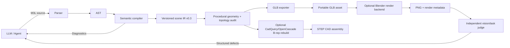

# M3L system architecture — v0.3

## Design goals

1. **LLM-friendly:** compact declarations, explicit semantics, stable names, low syntax ambiguity.
2. **Deterministic:** the same source/compiler version produces a stable scene IR and geometry, excluding documented metadata.
3. **Inspectable:** diagnostics, mesh audits and scene IR are structured outputs rather than prose-only feedback.
4. **Safe by default:** M3L is data, never arbitrary Python/shell code. Geometry work is bounded.
5. **Interoperable:** GLB is the portable delivery format; optional CadQuery/OpenCascade exports CAD B-rep STEP assemblies, and Blender is an optional render backend. OpenUSD and language-level CSG are future work.
6. **Reviewable:** deterministic checks and perceptual review are separate stages.

## Data flow

## Modules

- `parser.py`: a constrained declarative grammar and source tracking. No `eval`, imports, embedded scripts or dynamic execution.
- `compiler.py`: field/type/range checking, material resolution, unit conversion, named object construction, transforms, arrays, AABB constraints, `supported_by` contact/footprint checks, feature graph integrity validation, semantic revision hashes, semantic scene diffs, normalized IR and safe patch helpers.
- `geometry.py`: deterministic triangulation, polygon extrusion, lathe/revolve surfaces, constant-radius path sweeps, and local edge/triangle/winding/volume audits.
- `glb.py`: GLB 2.0 serialization, primitives and custom indexed meshes, materials, camera/light metadata, and reusable mesh/material prototypes.
- `judge.py`: deterministic readiness checks and declared-constraint/topology diagnostics. It does not claim artistic judgment.
- `cadquery_backend.py`: optional CadQuery/OpenCascade adapter rebuilding supported objects as audited B-rep solids and exporting colored STEP assemblies with unit conversion.
- `blender_backend.py`: optional isolated Blender background-process adapter. It imports compiled GLB, applies a neutral render-only studio setup when required, and writes PNG plus metadata. The adapter is implemented but must be run on a system with Blender installed before a real render can be certified.
- `cli.py`: validate, inspect, compile, judge, semantic diff, asset bundle build/integrity verification and optional render commands.
- `api.py`: local HTTP endpoints for capabilities, schema, validation, semantic diff, revision-guarded patch candidates, judging, compile, optional STEP export and optional render.
- `viewer/index.html`: lightweight browser preview.
- `benchmarks/run_benchmark.py`: local compile/export microbenchmark; excludes LLM inference, network and rendering.
- `benchmarks/run_cad_benchmark.py`: local CadQuery build/STEP-export microbenchmark; excludes LLM inference and external applications.
- `scripts/build_cad_assets.py`: rebuilds and audits the example STEP assets and their manifest.
- `scripts/render_glb_previews.py`: optional VTK-based diagnostic previews for GLB assets; not a production renderer and not part of core runtime dependencies.

## Scene IR contract

The active schema identifier is `m3l.scene.v0.3`. It contains scene name, units metadata, materials, named objects, transforms, geometry, camera/lights, declared constraints, estimated bounds, summary counts, a validated feature graph and provenance. Asset revisions hash normalized semantic IR, excluding source line numbers and formatting; source hashes remain available separately. Semantic diffs address named objects/features and summarize large geometry changes by hash. Feature declarations still describe design history and do not yet generate geometry by themselves. Custom mesh objects carry local vertices, triangle indices and shading metadata. The IR is the target adapter contract; adapters should not reverse-engineer source text. The optional CadQuery backend reconstructs analytic/trimmed B-rep solids for box, sphere, cylinder, extrusion, revolve and sweep objects, then exports a colored assembly to STEP with explicit unit conversion.

## Geometry semantics

- `box`, `sphere`, `cylinder`: analytic primitive declarations converted into triangle meshes at export.
- `extrude`: a simple 2D `[x,z]` polygon extruded through positive thickness along Y; the profile must be simple and non-degenerate.
- `revolve`: a closed `[radius,y]` profile revolved around Y; radius must be non-negative.
- `sweep`: a constant-radius tube along a 3D polyline, using transported frames; this is not yet a spline or arbitrary cross-section sweep.
- `array`: bounded grid expansion, currently for box/sphere/cylinder only.

Mesh auditing checks invalid indices, degenerate triangles, edge incidence, oriented edge consistency, approximate volume and watertightness. It does **not** prove absence of triangle self-intersection, correct physical behavior, or CAD tolerance compliance. `supported_by` validates Y-up bottom/top contact and footprint containment for upright children against an unrotated box or extrusion, and may expand an array name into all members. Other constraints are AABB-based fast layout checks rather than exact collision tests.

## Backend boundaries

GLB/glTF is the portable asset output. CadQuery/OpenCascade reconstructs the supported object types as B-rep solids for STEP exchange; it does not yet expose language-level boolean operations or edit history. Blender is used optionally for richer rendering and later modeling operations. A production evolution should add capability declarations for each adapter and reject or explicitly degrade unsupported operations. OpenUSD composition, language-level CSG, physics, simulation and engine-specific scene export remain future work.

## AI control loop

Use a bounded controller:

1. Model generates M3L from a brief and acceptance criteria.
2. Compiler emits normalized IR or structured diagnostics.
3. Deterministic judge checks structural and declared constraints.
4. Export to GLB; optionally reconstruct B-rep solids with CadQuery/OpenCascade and export STEP.
5. Where Blender is installed, render with repeatable settings.
6. An independent vision/task evaluator returns named defects and confidence, not just a vague score.
7. The model proposes minimal named patches; recompile/review with a round budget.
8. Persist accepted source, IR, GLB/STEP/PNG hashes, metrics, render settings, model and prompt versions.

Generator and judge should be separate calls or models when possible. Never promote a result solely because the generating model says it looks good.

## Security posture

The compiler accepts constrained data only, and the Blender adapter executes a fixed bundled script rather than model-authored Python. Nevertheless, rendering consumes resources and can load complex assets. The HTTP API is unauthenticated and intended for loopback use. Remote deployments must add auth, request-size limits, process isolation, rate limits, timeouts, resource budgets, and artifact access controls.
