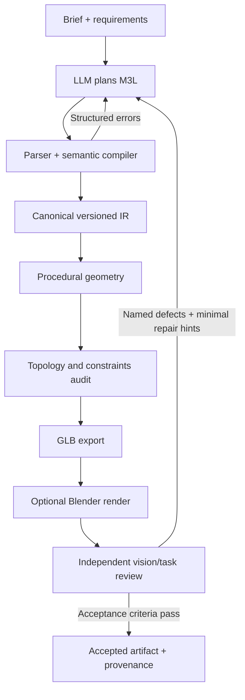

# M3L: AI-native 3D authoring system — software design

**Version:** 0.3.0, October 2026  
**Status:** executable language/compiler, procedural solid builders, geometric constraints, topology audits, GLB export, optional CadQuery/OpenCascade B-rep STEP export, deterministic preflight, local API and an optional Blender render adapter. Visual quality and performance superiority are not yet benchmark-proven.

## 1. Thesis

M3L treats 3D authoring as a compiler-and-feedback problem. An LLM states a design in a constrained declarative language. The compiler creates a versioned scene representation. Geometry builders/backend adapters produce assets. Deterministic checks establish machine-verifiable properties, and a separate visual/task evaluator judges the rendered result.

The hypothesis is that AI-first authoring can make structured 3D tasks more reliable by lowering ambiguity, enabling concise edits, reusing geometry, exposing precise errors and providing objective feedback. A new language alone cannot guarantee exponential gains; improvements must be measured against existing workflows.

## 2. Current implementation

### Language and compiler

M3L is a data-only DSL, with named objects/materials, transforms, explicit units, camera, lights, bounded primitive arrays, named AABB constraints, and a type-specific `supported_by` relationship. No source expression executes as Python or shell. The compiler enforces finite numbers, resource limits, references and geometry semantics and emits `m3l.scene.v0.3` IR.

### Geometry

- **Primitives:** box, sphere, cylinder.
- **Extrusion:** a simple 2D `[x,z]` polygon creates a custom indexed solid of positive Y thickness. Concave simple polygons are deterministically triangulated.
- **Revolve/lathe:** a simple closed `[radius,y]` profile forms rotational geometry around Y, including hollow forms when the contour defines a valid inner wall and rim.
- **Sweep:** a capped, constant-radius tube around a 3D polyline with transported frames. It is currently piecewise linear, not a general spline or arbitrary-section sweep.
- **Arrays:** bounded grid expansion for primitive types.

The `supported_by` constraint checks Y-up contact and full footprint containment, including concave extrusion profiles. It accepts a named array as its child so that each generated instance is verified; v0.3 conservatively rejects rotated targets and tilted children. Mesh audits detect malformed indices, degenerates, boundary/non-manifold edges, oriented-edge inconsistencies and approximate signed volume/watertightness. They do not prove that the mesh is self-intersection-free or suitable for manufacturing.

### Delivery and rendering

The standard-library exporter emits GLB with geometry, node transforms and material metadata. An optional CadQuery/OpenCascade backend reconstructs box/sphere/cylinder primitives, extrusions, revolves and sweeps as B-rep solids, audits them, and exports a colored STEP assembly with unit conversion. All six sample assemblies were round-tripped through STEP and checked for valid solids in this environment. General CSG booleans and feature-history editing are not exposed by the M3L language yet. Blender is a separate optional rendering backend that launches a fixed script in a background process and returns a PNG and metadata. Blender is not installed in the current development environment, so the adapter's missing-dependency behavior is tested but actual Blender pixels must be checked on a Blender-equipped machine.

### Agent integration

The HTTP API supports `/health`, `/v1/capabilities`, `/v1/schema`, `/v1/validate`, `/v1/judge`, `/v1/compile`, `/v1/patch`, `/v1/export/step`, and `/v1/render`. The STEP route returns a base64 assembly and per-body audit metadata, or `503 CAD_BACKEND_UNAVAILABLE` when CadQuery is missing. The render route returns `503 BLENDER_UNAVAILABLE` when Blender cannot be found. The deterministic judge must not be described as a visual evaluator.

## 3. Architecture

The source language handles intent and stable identities, the compiler handles deterministic semantics, the geometry module constructs bounded meshes, GLB is a delivery format, and the render/vision loop evaluates appearance. That separation keeps the DSL small and allows later OpenUSD, CAD and simulation adapters.

## 4. Why a language rather than prompts, JSON or generated Python?

- Natural language describes goals but leaves dimensions, axes, identity and edit scope ambiguous.
- JSON works well for transport and normalized IR but is verbose for authored scenes and diffs.
- Arbitrary generated Python is flexible but introduces execution security, nondeterminism and harder diagnostics.
- A constrained DSL gives the model stable names, machine-checkable properties and useful compiler feedback without executing model-authored code.

M3L should remain a compact front end. It should not attempt to replace mature renderers or geometry kernels.

## 5. Quality gates

1. **Language gate:** parse/type/reference/numeric/resource checks pass.
2. **Geometry gate:** expected topology checks, dimensions, bounds and named constraints—including supported-face contact/footprint checks where applicable—pass. Exact CAD requirements need a suitable kernel.
3. **Render gate:** repeatable render exists; no missing objects/materials, framing faults or obvious artifacts according to a separate evaluator.
4. **Task gate:** task-specific criteria and reference image checks pass.
5. **Provenance gate:** source, model/prompt version, scene IR, asset hashes and revisions are recorded.

A result may pass the first two gates yet fail the last visual gates. That is expected and should not be hidden by a single aggregate score.

## 6. Immediate roadmap

1. Run the Blender adapter on supported versions and add pinned render regression fixtures.
2. Add language-level boolean/loft/bevel/fillet operations that leverage the existing OpenCascade backend, with robust topology repair and explicit operation diagnostics.
3. Add true incremental dependency evaluation and versioned reusable prototypes.
4. Add UVs/textures/material graphs and explicit adapter capability negotiation.
5. Add OpenUSD and richer CAD exchange/adapters where valuable.
6. Publish a frozen task suite comparing M3L+LLM against direct LLM-to-Blender/CadQuery and established workflows at equal budgets.

## 7. Evaluation principles

Measure accepted-output rate, first-pass compile success, repair rounds, tokens, latency, constraint violations, render-task quality, mesh complexity and artifact size. Keep compiler-only timings separate from generation, rendering and model inference. Do not claim an exponential gain or superiority until comparative results support it.
